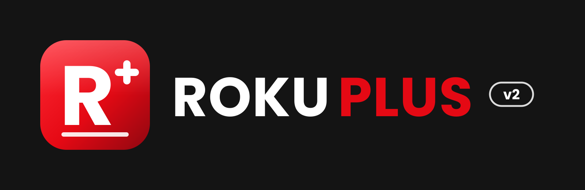
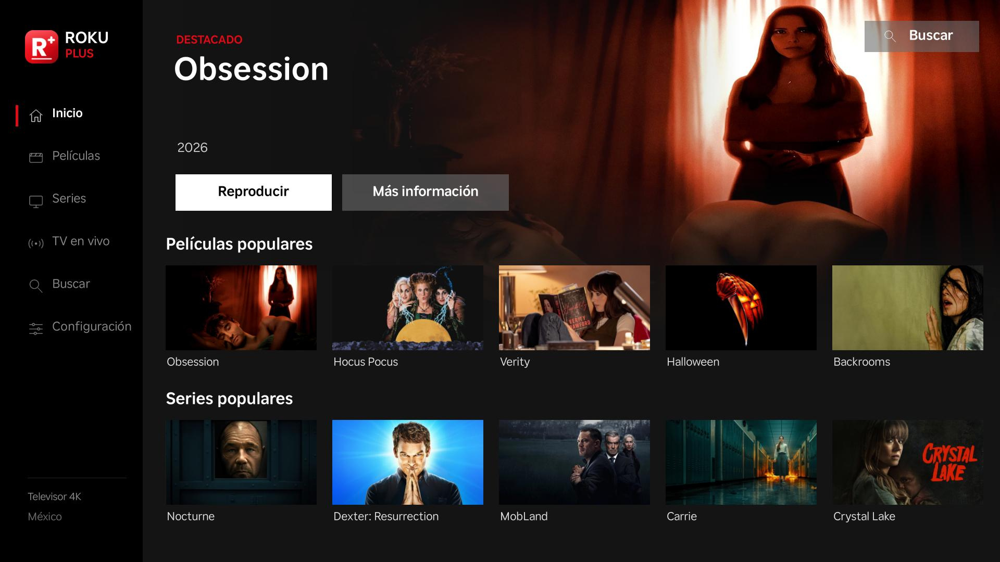

<p align="center">
  
</p>

# Roku Plus

App para Roku (BrightScript + SceneGraph) para ver películas, series y TV en vivo, con una interfaz oscura inspirada en Netflix.



## Funciones

- **Inicio:** una imagen destacada a todo lo ancho, con los botones Reproducir y Más información, y filas horizontales de películas y series populares.
- **Películas y Series:** catálogo en cuadrícula con paginación.
- **Detalle:** fondo a pantalla completa con sinopsis, año y duración. En las series hay lista de episodios por temporada.
- **Buscador:** teclado en pantalla con resultados en vivo y pestañas Películas/Series. Se abre con el botón **Buscar**, desde la barra lateral o con la tecla `*`.
- **TV en vivo:** canales de tu país y de LATAM, vista previa, favoritos y búsqueda de canales.
- **Reproductor propio:** controles de avance y retroceso, y barra de progreso.
- **Dos modos de catálogo:** HD / Full HD (fuentes H.264 compatibles) y 4K.
- **Configuración:** televisor, país o región, catálogo HD y créditos.

## Requisitos

- Una Roku con el [modo desarrollador](https://developer.roku.com/docs/developer-program/getting-started/developer-setup.md) activado.
- La Roku y tu computadora en la misma red.

## Instalación

1. Empaqueta la app desde la raíz del proyecto:

   ```bash
   zip -qr roku-plus.zip manifest source components images data -x "*.DS_Store"
   ```

2. Abre `http://<IP-de-tu-Roku>` en el navegador e inicia sesión con tu usuario de desarrollador (`rokudev`).
3. Pulsa **Upload**, elige `roku-plus.zip` y luego **Install with zip** (o **Replace with zip** si ya estaba instalada).

También puedes instalarla desde la terminal:

```bash
curl --user rokudev --digest \
  -F "mysubmit=Install" -F "archive=@roku-plus.zip" \
  http://<IP-de-tu-Roku>/plugin_install
```

## Controles

| Tecla | Acción |
|---|---|
| ← ↑ → ↓ | Moverte por la interfaz |
| OK | Seleccionar o reproducir |
| `*` | Abrir el buscador (en TV en vivo: marcar favorito) |
| ⟲ | Borrar la última letra en el buscador |
| Atrás | Volver a la pantalla anterior |

## Estructura

```
manifest            Datos del canal (versión, íconos, pantalla de arranque)
source/             Lógica pura: datos de catálogo, filas del Home, preferencias, TV en vivo
components/
  PlusScene.*       Escena principal: estado, navegación y control remoto
  PlusSceneViews.brs  Dibujo de cada pantalla (estilo Netflix)
  PlusSearch.brs    Buscador con teclado en pantalla
  PlusPlayer.*      Reproductor de video
  *Task.*           Tareas en segundo plano que consultan los catálogos
images/             Íconos, pantalla de arranque y recursos de la interfaz
docs/brand/         Logo Roku Plus v2 (PNG y SVG)
```

## Versión

**v2 (1.7.1):** rediseño completo estilo Netflix, nuevo buscador y nuevo logo.
